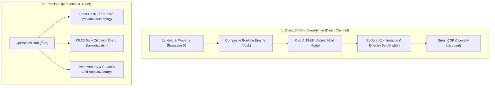

# Yoonie — Product & Design Guidelines

> **Tagline:** *every booking, closed.*  
> **Brand Mission:** Empower independent boutique hotels and multi-service operators with a unified, direct-channel booking engine and synchronized frontline dispatch operations.

---

## 1. Brand Identity & Visual Language

Yoonie blends warm, boutique hospitality charm with operational rigor. It avoids sterile corporate enterprise UI in favor of an inviting, organic, tactile visual design that feels like checking into a high-end riverside sanctuary.

### 1.1 Color Palette

| Token Name | Hex Code | Role & Semantic Usage |
| :--- | :--- | :--- |
| **Forest Green** | `#28594E` | **Primary Brand Color**: Navigation headers, primary action buttons, key headings, active navigation states, high-contrast borders. |
| **Soft Sage** | `#D8E6DA` | **Secondary / Surface Tint**: Badge backgrounds, soft chips, subtle card borders, hover states, gentle pill accents. |
| **Warm Linen** | `#F5EBDD` | **Primary Canvas / Neutral Light**: Main page background, card surfaces, modal backgrounds, warm textured fills. |
| **Honey Amber** | `#E8A45B` | **Accent / Attention / VIP**: VIP guest badges, cart hold countdown timer, urgent dispatch warnings, highlights, star ratings. |
| **Charcoal** | `#303A36` | **Primary Typography / Deep Neutral**: Body text, titles, dark-mode surfaces, icons, high-legibility labels. |

#### Extended Semantic Tones
- **Success / Inspected Green**: `#236B56` (Room inspected, payment confirmed, order booked).
- **Critical / Urgent Coral**: `#D9534F` (Tour under-occupancy critical alert, hold expired, error banner).
- **Muted Sage Grey**: `#7A8B84` (Secondary helper labels, metadata timestamps, table borders).

---

### 1.2 Typography

- **Primary Brand & Display:** `Nunito`, `Avenir Next`, or `Inter` rounded. Friendly, approachable, premium curves reflecting hospitality.
- **Data, Figures & Monospace:** `Geist Mono` or `Roboto Mono` for order numbers (`TS-261020-A1B2C`), currency figures (`฿6,944.30`), room keys (`101`, `204`), and time codes (`14:30`).

---

### 1.3 Mascot Guide — Yoonie Expressions

The Yoonie mascot is an expressive, gentle nature spirit / companion that guides guests through booking and accompanies frontline staff through busy hotel shifts.

| Mascot Asset | Expression | Emotional Context & UI Trigger |
| :--- | :--- | :--- |
|  | **Happy / Celebrating** | • Booking payment confirmed • Room marked `INSPECTED` & ready for check-in • Daily dispatch tasks 100% completed • VIP guest profile milestone |
|  | **Calm / Welcoming** | • Landing page hero • Direct booking engine header • Guest portal welcome card • Default system state |
|  | **Checking Booking** | • Date & room availability search • Reviewing composite cart before checkout • Front-desk guest look-up • Itinerary details view |
|  | **Thinking / Calculating** | • Holding inventory slot in progress • Evaluating tour yield consolidation • Loading availability calendar • Price recalculation |
|  | **Worried / Urgent** | • 15-minute cart hold expiration countdown (< 3 mins) • Tour departures under minimum viable pax (Critical/Warn) • Dirty room arrival rush (ETA within 30 mins) • Payment failed or session expired |
|  | **Sleeping / Resting** | • All rooms clean and inspected • No active dispatch tasks left on daily board • Off-hours / night audit state • Empty search results |

---

## 2. Information Architecture — Target Pages

The Yoonie web application serves two synchronized experiences: **Guest Direct-Booking** and **Frontline Operations (Staff)**.

---

### 2.1 Guest-Facing Pages

#### Page 1: Landing & Property Showcase (`/`)
- **Audience:** Direct travelers seeking a boutique riverside experience.
- **Core Elements:**
  - Hero with `yoonie-calm.png` and tagline *"every booking, closed."*
  - Fast search bar: Dates (Check-In / Check-Out), Guests count, Property picker (`BKK Riverside Boutique Hotel`).
  - Featured offerings: Handcrafted Rooms, Waterfront Dining, Local Excursions & Airport Transfers.
  - Direct booking benefits banner: Guaranteed best rates, free airport transit perks, direct messaging.

#### Page 2: Composite Direct Booking Engine (`/book`)
- **Audience:** Guests building their stay reservation.
- **Core Elements:**
  - **Multi-Product Tabs or Unified Flow:**
    1. **Rooms**: Available room types (`STANDARD_KING`, `DELUXE_BALCONY`, `POOL_VILLA`) with live availability counts from `GET /inventory/availability`.
    2. **Dining Add-ons**: Table reservations at Riverside Terrace & The Siam Lounge with meal shifts (`BREAKFAST`, `ALL_DAY`, `EVENING`).
    3. **Experiences & Logistics**: Airport Transfer (with flight number & terminal), Floating Market tour, Thai Spa wellness.
  - **Dynamic Composite Cart (Floating Drawer/Sidebar):**
    - Instant price breakdown: Subtotal + 10% Service Charge + 7% VAT = Grand Total.
    - 15-minute atomic hold trigger (`POST /inventory/hold`) when proceeding to checkout.
    - Countdown timer with `yoonie-worried.png` if < 3 minutes remaining.

#### Page 3: Checkout & Attribution Modal/Step
- **Audience:** Guest finalizing reservation.
- **Core Elements:**
  - Guest contact fields: Full Name, Email, Phone (E.164), LINE User ID (with 1-click LINE connect), preferred language (`EN` / `TH`).
  - Auto-captured UTM Attribution parameters (`utm_source`, `utm_medium`, `utm_campaign`, `channel: DIRECT_WEB`).
  - Instant confirmation action calling `POST /orders` and `POST /orders/:id/confirm`.

#### Page 4: Order Confirmation & Live Itinerary (`/orders/[id]`)
- **Audience:** Confirmed guests viewing their stay and vouchers.
- **Core Elements:**
  - Confirmed banner with `yoonie-happy.png` and order reference code (`TS-261020-XXXXX`).
  - Itemized itinerary cards:
    - Room stay with check-in/out times.
    - Dining reservation with reserved shift.
    - Tour / Transfer card: Driver name, vehicle plate, meeting door, and **bilingual EN/TH pickup card** generated by backend rules.
  - Quick action: "Save to LINE" / "Download Itinerary PDF".

#### Page 5: Guest Profile & CDP Portal (`/account`)
- **Audience:** Returning guests.
- **Core Elements:**
  - Guest VIP badge (`vipScore`, `vipTier`, lifetime stay count, total spend).
  - Active & past bookings history.
  - Contact preferences (WhatsApp opt-in, LINE ID, preferred language).

---

### 2.2 Staff & Operations Pages

#### Page 6: Front-Desk Zero Housekeeping Board (`/ops/housekeeping`)
- **Audience:** Housekeeping supervisors, room attendants, front-desk agents.
- **Device Optimization:** Tablet & Mobile first.
- **Core Elements:**
  - 4 Kanban columns / Filter views:
    - **DIRTY** (Prioritized by guest arrival ETA and VIP status!).
    - **IN_PROGRESS** (Currently being cleaned).
    - **CLEAN** (Cleaned, awaiting front-desk inspection).
    - **INSPECTED** (Green & ready for guest key handover).
  - Room cards showing: Room number, Room type, Assigned cleaner, Guest ETA, VIP badge.
  - 1-tap quick action button: `DIRTY` → `IN_PROGRESS` → `CLEAN` → `INSPECTED` calling `PATCH /rooms/:id/cleaning`.
  - Empty state with `yoonie-sleeping.png` when all rooms are clean.

#### Page 7: Morning Operations Run-Sheet & Dispatch Hub (`/ops/dispatch`)
- **Audience:** Operations managers, tour coordinators, lead drivers.
- **Core Elements:**
  - Service date picker (`YYYY-MM-DD`, defaults to today).
  - Priority task run-sheet from `GET /dispatch?branchId=...&serviceDate=...`:
    - **Housekeeping Turnaround**: Urgent arrival rooms with priority scores > 100.
    - **Tour Yield Consolidation**: Flagged departures with `CRITICAL` or `WARN` badges when pax < `minViablePax` or branch threshold, displaying projected loss in THB and merge options.
    - **Airport Transit**: Arrival pickups with flight numbers, vehicle plates, drivers, and copyable bilingual EN/TH guest greeting cards.
  - Task progress toggles: `OPEN` → `ACKNOWLEDGED` → `IN_PROGRESS` → `DONE`.

#### Page 8: Live Inventory & Capacity Matrix (`/ops/inventory`)
- **Audience:** Revenue managers and front-office supervisors.
- **Core Elements:**
  - Grid view of inventory slots across dates:
    - Capacity vs. Held vs. Booked for each room type, dining shift, and tour departure.
    - Visual indicators for sellout risks and open hold releases.

---

## 3. UI Component Design Principles

1. **Rich Aesthetics & Premium Feel:**
   - Soft rounded cards (`rounded-2xl`, `rounded-3xl`) with gentle shadows (`shadow-[0_4px_20px_rgba(40,89,78,0.06)]`).
   - Organic color pairing: Warm Linen surfaces `#F5EBDD` grounded with Forest Green `#28594E` and Soft Sage `#D8E6DA` accents.
   - Distinctive typography blending hospitable warmth and crisp numeric legibility.
2. **Contextual Mascot Interventions:**
   - Small, non-intrusive mascot callouts delivering helpful context (e.g. `yoonie-thinking.png` while reserving capacity, `yoonie-happy.png` on completion).
3. **Frontend Architecture Continuity:**
   - Maintain MVVM architecture (`modules/<feature>/viewModel` + `modules/<feature>/view`).
   - Domain-level API modules in `lib/domain/` consuming `NetworkManager` for centralized envelope handling.
   - TanStack React Query for smooth optimistic UI updates and cache invalidation.
