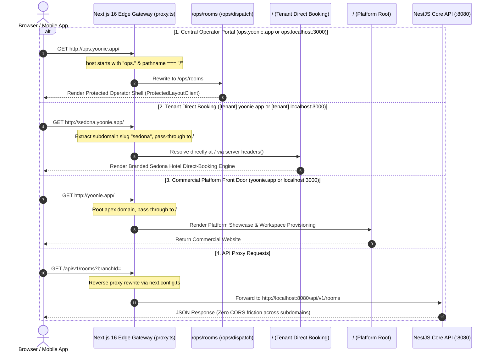
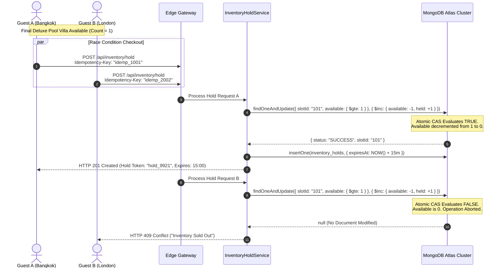
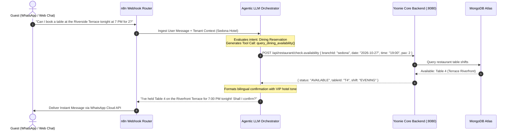
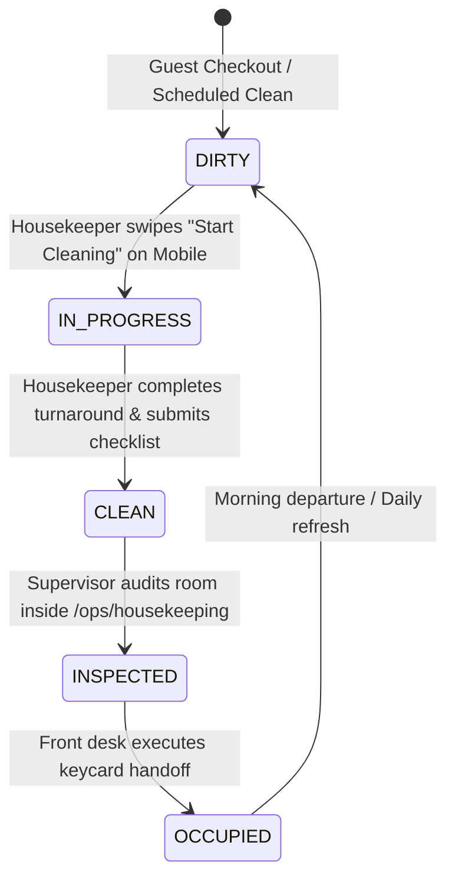
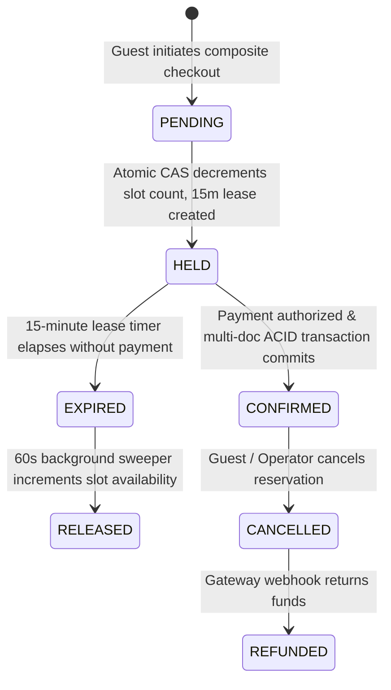
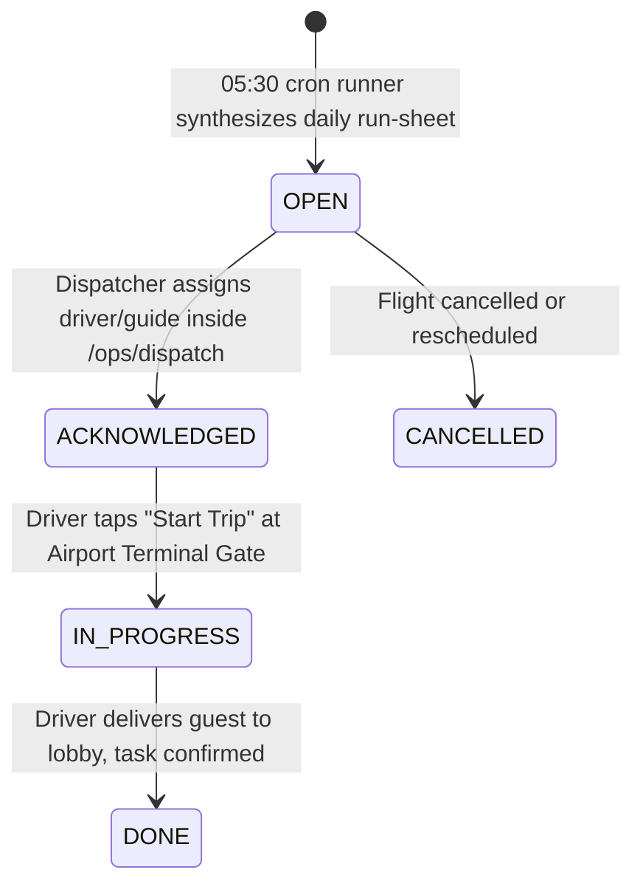

# Yoonie Frontend — Architecture & System Topologies

> **Tagline:** *Every booking, closed. Every morning, automated.*  
> **Ecosystem:** 4 Decoupled Repositories (`yoonie-landing-page`, `yoonie-frontend`, `yoonie-backend`, `yoonie-mobile-staff`) spanning Edge Ingress, Multi-Tenant Web, Autonomous Backend, and Frontline Mobile.

---

## 1. Master System Topology

```
========================================================================================================================
                      YOONIE UNIFIED HOSPITALITY OPERATING SYSTEM — MASTER ARCHITECTURE
========================================================================================================================

                                                 [ INTERNET / CLIENTS ]
                                                            │
                     ┌──────────────────────────────────────┼──────────────────────────────────────┐
                     │                                      │                                      │
                     ▼                                      ▼                                      ▼
       [ Guest Direct Web / Booking ]             [ Hotel Operators / Staff ]             [ Public Web Traffic ]
            sedona.yoonie.app                         ops.yoonie.app                             yoonie.app
          (*.yoonie.app Tenants)                 (Central Operations Hub)                  (Commercial Marketing)
                     │                                      │                                      │
                     └──────────────────────────────────────┼──────────────────────────────────────┘
                                                            │
                                                            ▼
┌──────────────────────────────────────────────────────────────────────────────────────────────────────────────────────┐
│ 1. EDGE NETWORK & DNS INGRESS LAYER (CLOUDFLARE)                                                                     │
│                                                                                                                      │
│  • Anycast DNS:          A Record: yoonie.app ──> 76.76.21.21 (Vercel Anycast)                                       │
│                          Wildcard CNAME: *.yoonie.app ──> cname.vercel-dns.com                                       │
│                          API CNAME: api.yoonie.app ──> cname.vercel-dns.com                                          │
│  • Edge Security:        WAF Rules, Managed DDoS Mitigation, Bot Management, Rate Limiting (120 req/min/IP)          │
│  • Edge SSL / TLS:       TLS 1.3 Termination, Automated Wildcard Certificate (*.yoonie.app, *.yoonie.si)            │
└───────────────────────────────────────────────────────────┬──────────────────────────────────────────────────────────┘
                                                            │
                                                            ▼
┌──────────────────────────────────────────────────────────────────────────────────────────────────────────────────────┐
│ 2. VERCEL HOSTING & EDGE ROUTING LAYER                                                                               │
│                                                                                                                      │
│  • Ingress Gateway:      Vercel Edge Network Wildcard Resolution (*.yoonie.app)                                      │
│  • Edge Proxy (proxy.ts):Inspects `Host` Header ──> Resolves Subdomain:                                              │
│                          ├─ Host === "ops.yoonie.app" ──────────> Rewrite to /ops/rooms or /ops/dispatch              │
│                          ├─ Host === "[tenant].yoonie.app" ─────> Pass-through to / with Tenant Context Injected     │
│                          ├─ Host === "yoonie.app" ──────────────> Pass-through to Commercial Landing Engine           │
│                          └─ Path === "/api/*" ──────────────────> Reverse Proxy to Backend API (Same-Origin / Zero CORS)│
└────────────┬──────────────────────────────────────────────┬──────────────────────────────────────────────────────────┘
             │                                              │
             ▼                                              ▼
┌─────────────────────────────────────────┐    ┌───────────────────────────────────────────────────────────────────────┐
│ REPO: yoonie-landing-page               │    │ REPO: yoonie-frontend (Next.js 16 App Router)                         │
│ (Commercial Marketing Platform)         │    │ (Multi-Tenant Direct Booking + Central Ops Hub)                       │
│                                         │    │                                                                       │
│  • Commercial landing & ROI calculator  │    │  [ Surface A: Tenant Guest Engine: [slug].yoonie.app ]                │
│  • Instant Hotel Workspace Onboarding   │    │  • Room Catalog & Real-Time Availability Checks                       │
│  • Provisions:                          │    │  • Unified Composite Cart (Room + Dining + Boat Tour + Airport Fleet) │
│    Tenant DB Record + Wildcard Subdomain│    │  • 15-Minute Atomic Cart Hold Countdown & Token Store                 │
│    (sedona.yoonie.app live in <60s)     │    │                                                                       │
│                                         │    │  [ Surface B: Central Operator Hub: ops.yoonie.app ]                  │
│                                         │    │  • Admin Property CMS: /admin (Rooms, Menus, Pricing, Surcharges)     │
│                                         │    │  • 05:30 Morning Dispatch Hub: /ops/dispatch (Flight & Driver Board)  │
│                                         │    │  • Digital Housekeeping Board: /ops/housekeeping (Dirty/Clean States) │
│                                         │    │  • Auth Protection: ProtectedLayoutClient + useRequireAuthVm()        │
└─────────────────────────────────────────┘    └───────────────────────────────────┬───────────────────────────────────┘
                                                                                   │
                                                        HTTP /api/* (JSON)         │
                                                        Authorization: Bearer <JWT>│
                                                        Idempotency-Key: <UUID>    │
                                                                                   ▼
┌──────────────────────────────────────────────────────────────────────────────────────────────────────────────────────┐
│ 3. CORE BACKEND PLATFORM LAYER                                                                                       │
│    REPO: yoonie-backend (NestJS 10 Distributed Architecture on Express)                                              │
│                                                                                                                      │
│  ┌────────────────────────────────────────────────────────────────────────────────────────────────────────────────┐  │
│  │ ZERO-TRUST SECURITY & ACCESS CONTROL PIPELINE                                                                  │  │
│  │  • AuthModule:                                                                                                 │  │
│  │    - 15-Min Stateless Access Token (HMAC-SHA256 JWT): { sub, email, role, branchIds, defaultBranchId }        │  │
│  │    - 7-Day Rotating Refresh Token (SHA-256 Hash stored in DB with device fingerprint & reuse revocation chain) │  │
│  │  • Single-Flight Refresh Mutex (NetworkManager): Queues parallel requests on 401; auto-replays on fresh token   │  │
│  │  • TenantContextGuard: Enforces request.branchId ∈ user.branchIds (Hard multi-tenant data leak protection)     │  │
│  │  • 5-Tier RBAC Matrix: @Roles(ADMIN, BRANCH_MGR, DISPATCHER, STAFF, GUEST)                                    │  │
│  └────────────────────────────────────────────────────────────────────────────────────────────────────────────────┘  │
│                                                                                                                      │
│  ┌────────────────────────────────────────────────────────────────────────────────────────────────────────────────┐  │
│  │ CONCURRENCY, ATOMIC LOCKING & IDEMPOTENCY ENGINE                                                               │  │
│  │  • Idempotency-Key Guard: Mutex lock on <Idempotency-Key> UUID prevents duplicate credit card or seat charges  │  │
│  │  • Atomic CAS Decrement:                                                                                       │  │
│  │      db.inventory_slots.findOneAndUpdate(                                                                      │  │
│  │        { _id: slotId, branchId: targetBranch, available: { $gte: qty } },                                      │  │
│  │        { $inc: { available: -qty, held: +qty } }                                                                │  │
│  │      )                                                                                                         │  │
│  │      ──> Evaluates TRUE: Slot locked. Evaluates FALSE: HTTP 409 Conflict. ZERO DOUBLE-BOOKINGS.                │  │
│  │  • 15-Min TTL Hold Leases: Temporary hold tokens stored in `inventory_holds` collection with automatic TTL     │  │
│  │  • ACID Multi-Document Transactions: Multi-item composite checkout (Villa + Yacht + Dinner) commits as ONE unit│  │
│  └────────────────────────────────────────────────────────────────────────────────────────────────────────────────┘  │
│                                                                                                                      │
│  ┌────────────────────────────────────────────────────────────────────────────────────────────────────────────────┐  │
│  │ AUTOMATED CRON ENGINE & NODE SCHEDULER (Distributed Workers)                                                   │  │
│  │  • 05:30 Dispatch Runner (CRON: 30 5 * * *): Pre-calculates daily operational run-sheets at 05:30 AM sunrise;   │  │
│  │    matches incoming flights (e.g. TG917) to driver rosters, sets housekeeping turnaround priorities by VIP tier│  │
│  │  • 60s Hold Expiry Sweeper (CRON: * * * * *): Scans expired leases; reverts unpurchased items to available pool│  │
│  │  • Tour Yield Consolidator (CRON: 0 */2 * * *): Flags shared boat excursions under 4-pax threshold 24h prior    │  │
│  └────────────────────────────────────────────────────────────────────────────────────────────────────────────────┘  │
│                                                                                                                      │
│  ┌────────────────────────────────────────────────────────────────────────────────────────────────────────────────┐  │
│  │ DOMAIN MICROSERVICES (14 BOUNDED CONTEXTS)                                                                     │  │
│  │  • RoomModule        • RestaurantModule     • ServiceModule (Tours)   • InventoryModule (CAS Holds)            │  │
│  │  • OrderModule       • DispatchModule       • StaffModule             • BranchModule (Multi-Tenant Config)     │  │
│  │  • DevicesModule     • NotificationsModule  • AuditModule             • AssistantModule (AI Concierge)         │  │
│  └────────────────────────────────────────────────────────────────────────────────────────────────────────────────┘  │
└───────────────────────┬──────────────────────────────────────────────────────────┬───────────────────────────────────┘
                        │                                                          │
                        ▼                                                          ▼
┌──────────────────────────────────────────────────────┐  ┌────────────────────────────────────────────────────────────┐
│ 4. MULTI-TENANT PERSISTENCE LAYER                    │  │ 5. AI ENGINE & OMNI-CHANNEL NOTIFICATION MESH              │
│    MONGODB ATLAS REPLICA SET CLUSTER                 │  │                                                            │
│                                                      │  │  • Webhook Bus: n8n Workflow Automation Cluster            │
│  • Single-DB Logical Multi-Tenant Partitioning:      │  │    (Triggers on: OrderCreated, FlightDelayed, DispatchSync)│
│    Every collection enforces mandatory foreign key:  │  │                                                            │
│    `branchId` (or `tenantId`)                        │  │  • Data-Grounded AI Concierge (Agentic LLM):               │
│                                                      │  │    - Real-time tool execution against backend APIs:         │
│  • Compound Performance Indexes:                     │  │      * lookup_room_availability(branchId, dates)           │
│    { branchId: 1, slug: 1 }                          │  │      * get_dining_table_slots(branchId, date, shift)       │
│    { branchId: 1, status: 1, date: 1 }               │  │      * create_housekeeping_ticket(branchId, roomKey)       │
│    { branchId: 1, checkInDate: 1 }                   │  │    - Injected Tenant Context: Currency, tax, house rules   │
│                                                      │  │                                                            │
│  • 9 Core Collections:                               │  │  • Notification Channels:                                 │
│    1. `branches`              (Tenant Configurations)│  │    - WhatsApp Business Cloud API: Bilingual Driver Cards   │
│    2. `users`                 (Identities & RBAC)    │  │    - LINE Official Account: Frontline Supervisor Alerts    │
│    3. `rooms`                 (Keys & Cleaning Board)│  │    - Google FCM Push: Real-Time Mobile Task Synchronization│
│    4. `restaurants`           (Outlets, Shifts, Tables)  - Twilio SMS / SendGrid: Tax Invoices & QR Check-In Pass    │
│    5. `services`              (Tours, Spa, Transfers)└──────────────────────────────┬─────────────────────────────┘
│    6. `inventory_slots`       (Atomic Capacity Counts)                               │
│    7. `inventory_holds`       (15-Min Leases with TTL)                               │ FCM Push Notifications
│    8. `orders`                (Composite Carts)                                      │ Task Assignment & Updates
│    9. `operational_dispatches`(05:30 Daily Run-Sheet)                                │
└──────────────────────────────────────────────────────┘                               │
                                                                                       ▼
┌──────────────────────────────────────────────────────────────────────────────────────────────────────────────────────┐
│ 6. FRONTLINE MOBILE APPLICATION LAYER                                                                                │
│    REPO: yoonie-mobile-staff (React Native / Expo for iOS & Android)                                                 │
│                                                                                                                      │
│  • Target Audience:  Airport Fleet Drivers & Floor Housekeeping Attendants                                           │
│  • Provisioning:     No public signup; accounts provisioned strictly by Branch Manager inside ops.yoonie.app         │
│  • Role Routing:     jobTitle === "DRIVER"       ──> Routes to /(app)/driver (Flight ETA, gate, meeting doors)      │
│                      jobTitle === "HOUSEKEEPER"  ──> Routes to /(app)/housekeeper (Dirty queue, swipe to start clean)│
│  • Offline Engine:   Embedded SQLite task database caches local runs; drivers in airport basements or attendants in  │
│                      concrete elevator shafts update tasks offline; auto-syncs to backend when signal recovers.      │
└──────────────────────────────────────────────────────────────────────────────────────────────────────────────────────┘
```

---

## 2. Ingress & Subdomain Resolution Sequence (`proxy.ts`)



---

## 3. Zero-Trust Authentication & Silent Refresh Mutex Sequence

```mermaid
sequenceDiagram
    autonumber
    actor User as Client Browser / Mobile
    participant NM as NetworkManager (Single-Flight Mutex)
    participant Store as tokenStore (In-Memory)
    participant AuthAPI as NestJS AuthController (:8080)
    participant DB as MongoDB Atlas

    Note over User,AuthAPI: 1. Authoritative Sign-In (/login)
    User->>NM: login("kanya@riverside-bkk.example", "Password123!")
    NM->>AuthAPI: POST /api/auth/login
    AuthAPI->>DB: Verify bcrypt password hash & issue token family
    DB-->>AuthAPI: User record { role: "ADMIN", branchIds: [...] }
    AuthAPI-->>NM: { accessToken (15m), refreshToken (7d), user }
    NM->>Store: Set in-memory accessToken & refreshToken
    NM-->>User: Auth Success (Redirect to /ops/dispatch)

    Note over User,AuthAPI: 2. Silent Refresh on HTTP 401 with Stampede Prevention
    User->>NM: Parallel GET /api/v1/rooms & GET /api/v1/orders
    NM->>AuthAPI: Headers: Bearer ExpiredToken
    AuthAPI-->>NM: 401 Unauthorized

    rect rgb(20, 30, 45)
        Note over NM: Single-Flight Mutex Activated: this.refreshPromise created<br/>Parallel request attaches to existing promise
        NM->>AuthAPI: POST /api/auth/refresh { userId, refreshToken }
        AuthAPI->>DB: Atomically rotate refresh token (Detect reuse)
        DB-->>AuthAPI: New Token Pair Issued
        AuthAPI-->>NM: { accessToken: "fresh_jwt", refreshToken: "new_refresh" }
        NM->>Store: updateTokens(fresh_jwt, new_refresh)
    end

    Note over NM,User: Replay queued requests with fresh_jwt
    NM->>AuthAPI: GET /api/v1/rooms with fresh_jwt
    AuthAPI-->>User: HTTP 200 OK
```



---

## 4. Concurrency & 15-Minute Atomic Hold Sequence



---

## 5. Automated 05:30 Morning Dispatch Run-Sheet Sequence

```mermaid
sequenceDiagram
    autonumber
    participant Cron as Node Scheduler (05:30 AM)
    participant Engine as DispatchSynthesisEngine
    participant DB as MongoDB Atlas
    participant N8N as n8n Webhook Bus
    participant Mobile as yoonie-mobile-staff (FCM)

    Cron->>Engine: Trigger executeMorningDispatchJob()
    Engine->>DB: Query Confirmed Orders for Today { checkIn: TODAY }
    DB-->>Engine: [ Villa Bookings, TG917 Flight Pickups, Longtail Tours ]

    rect rgb(20, 30, 45)
        Note over Engine: 1. Synthesize Airport Transfers (Match Driver Somchai with Flight TG917)<br/>2. Group Island Excursions (Check-in time & Pier Gates)<br/>3. Compute Housekeeping Turnaround Priorities by Guest Arrival ETA
        Engine->>DB: Bulk Write to operational_dispatches
    end

    Engine->>N8N: POST /webhook/morning-dispatch-ready { branchId, taskCount }
    N8N->>Mobile: Send FCM Push Notification to Drivers & Housekeepers
    Mobile-->>Engine: Staff Mobile Acknowledges Roster Sync
    Note over Engine: Dispatch run-sheet live at ops.yoonie.app/ops/dispatch
```



---

## 6. Real-Time Data-Grounded AI Concierge Sequence



---

## 7. State Transition Lifecycles

### A. Housekeeping Room Turnaround State Machine


### B. Composite Order & 15-Minute Hold Lease State Machine


### C. Operational Dispatch Task Lifecycle


---

## 8. Documentation Index

- [**`docs/CTO_TECHNICAL_WHITEPAPER.md`**](./docs/CTO_TECHNICAL_WHITEPAPER.md): Complete architecture blueprint and code contracts.
- [**`public/tech-whitepaper.html`**](./public/tech-whitepaper.html): Interactive and print-to-PDF ready whitepaper with SVG vector topology.
- [**`docs/ARCHITECTURE.md`**](./docs/ARCHITECTURE.md): Frontend MVVM architecture, directory structure, and edge proxy rules.
- [**`docs/SYSTEM_FLOWS.md`**](./docs/SYSTEM_FLOWS.md): Detailed operational workflows and sequence diagrams.
- [**`docs/DATA_MODEL.md`**](./docs/DATA_MODEL.md): MongoDB Entity-Relationship Diagram (ERD) and collection schemas.
