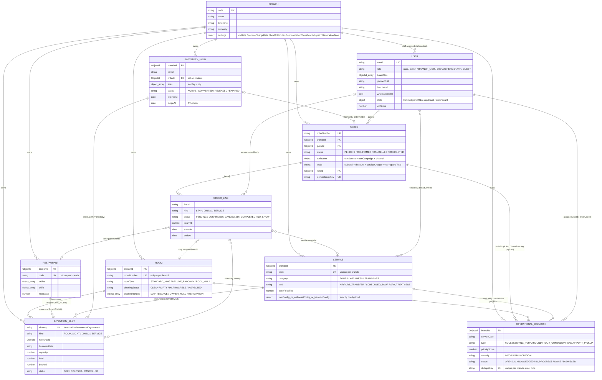
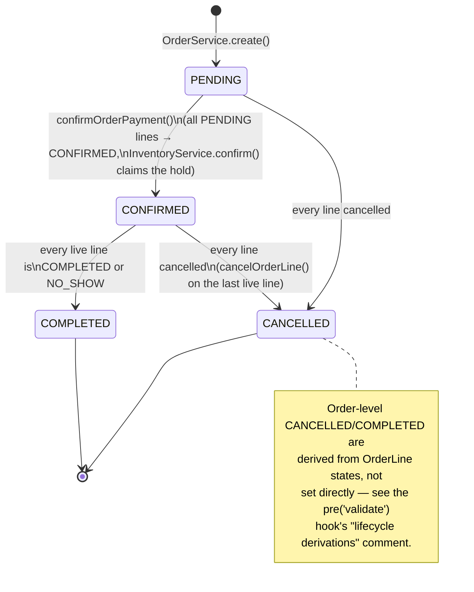
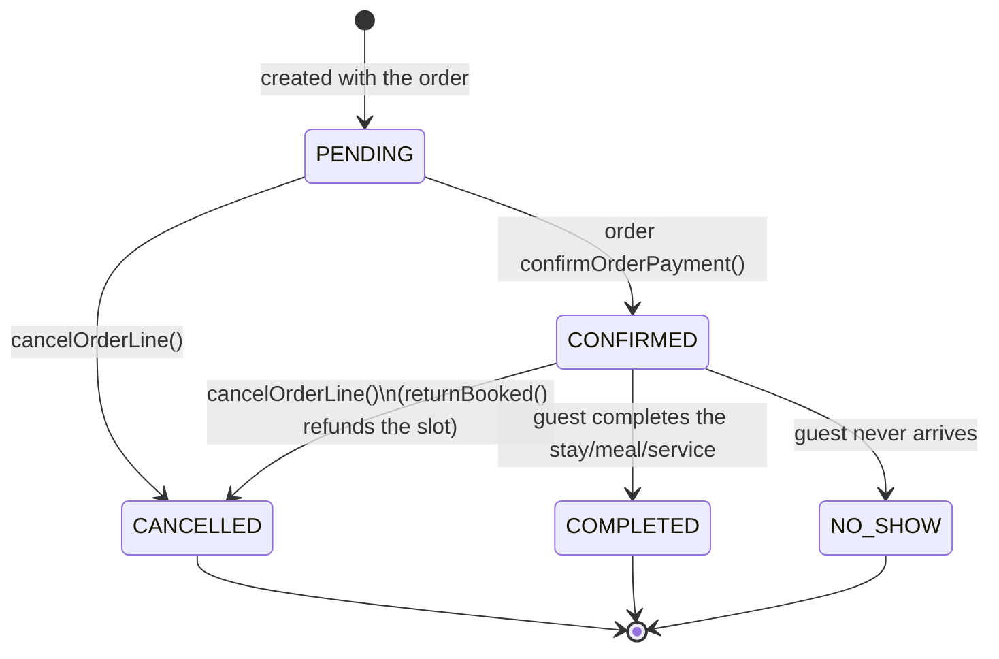
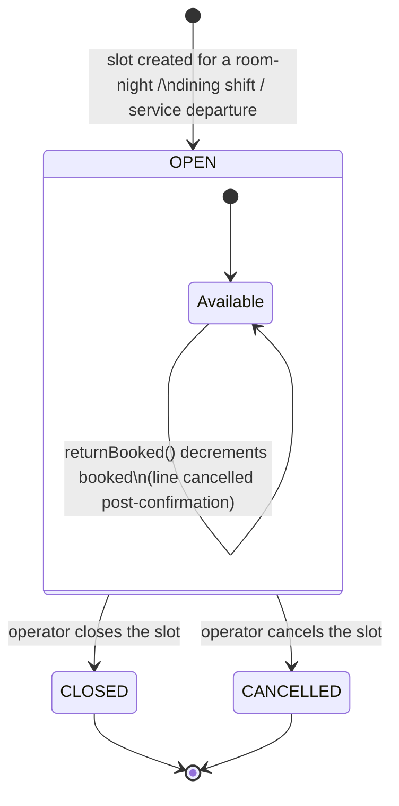
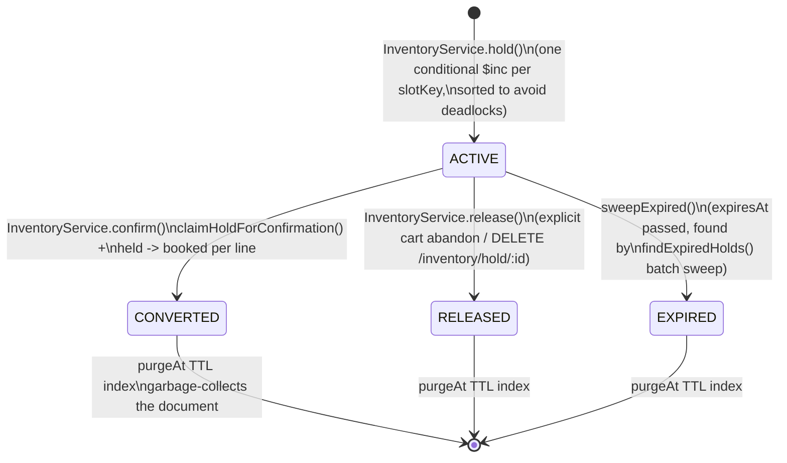
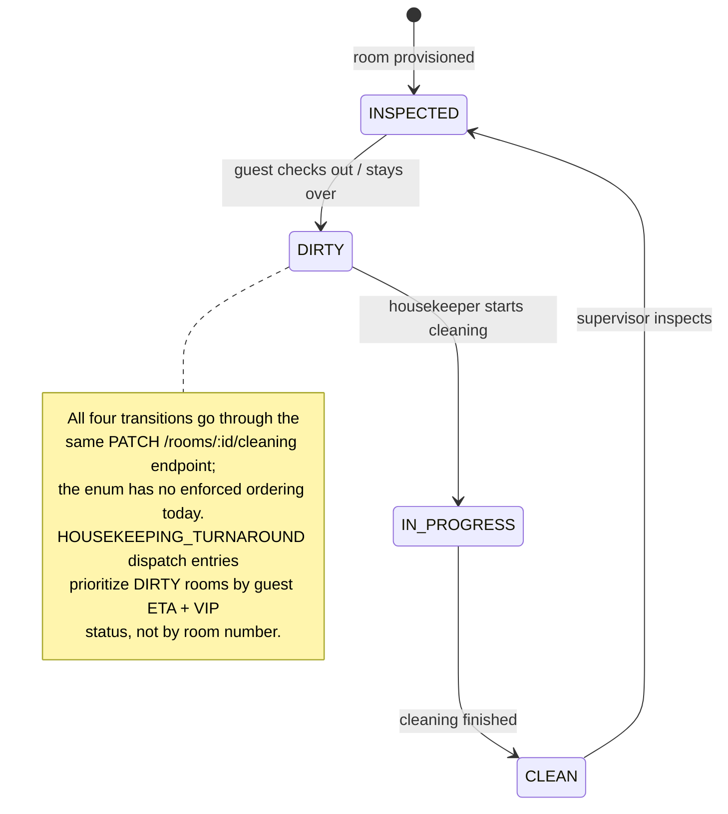
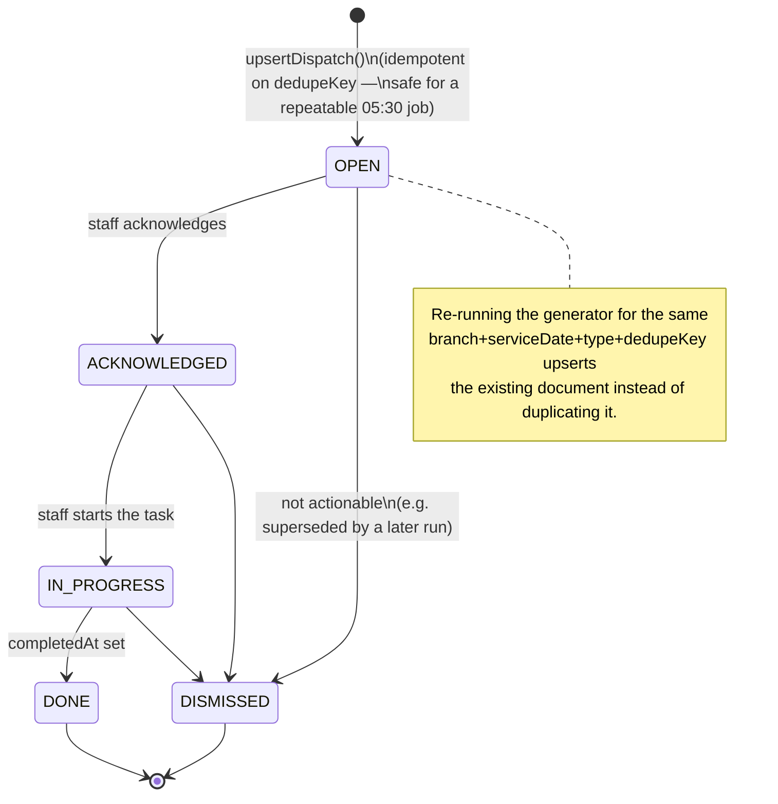

# Data Model & Lifecycles

Reference diagrams for the `yoonie-backend` MongoDB schema: how the 9 collections relate, and the state machines governing `Order`, `InventorySlot`, `InventoryHold`, `Room`, and `OperationalDispatch` documents.

See [`PRODUCT.md`](../PRODUCT.md) for why these models exist, and [`README.md`](../README.md) for the module/folder architecture.

## Collections at a glance

| Collection | Role |
|---|---|
| `branches` | Tenant root — one per property, carries operational settings |
| `users` | Staff **and** guests (guest CDP fields live on the same model) |
| `rooms` | Physical keys + housekeeping state only — never computes availability |
| `restaurants` | F&B outlets — static table/shift config only |
| `services` | Tours / spa / transfer catalog — static config + per-kind pricing |
| `inventory_slots` | The one sellable-capacity unit (room-night, dining shift, service departure) |
| `inventory_holds` | Short-lived soft reservation on one or more slots, used by a cart |
| `orders` | Composite, guest-facing booking — what's actually paid for |
| `operational_dispatches` | Generated daily run-sheet entries (housekeeping, consolidation, pickups) |

---

## 1. Entity-Relationship Diagram

`ORDER_LINE` is embedded inside `ORDER.items[]`, not its own collection — it's broken out above only so its references (to Room/Restaurant/Service/User/InventorySlot) are visible. Same for the three `SERVICE` config variants (`tourConfig`/`wellnessConfig`/`transferConfig`) — exactly one is present per document depending on `kind`.

---

## 2. Order Lifecycle

Two state machines, deliberately decoupled: `OrderLine.status` is driven directly by API calls, while `Order.status` is **derived** from line states in a `pre('validate')` hook — it is never set independently of its lines (see `src/order/entity/order.entity.ts`).

### Order status (derived, never set directly except at creation)

### Order line status (set directly by API calls)

---

## 3. Inventory Lifecycle

Two closely-coupled state machines. `InventorySlot` tracks raw capacity counters (`held`/`booked` against `capacity`); `InventoryHold` is the soft-reservation document a cart holds, and its transitions move the slot counters atomically via `InventoryService`.

### InventorySlot (capacity counters, not a status field)

A slot has a `status` field (`OPEN`/`CLOSED`/`CANCELLED`, set by an operator) independent of its live `held`/`booked` counters, which move only through atomic conditional `$inc` operations:

### InventoryHold (the soft reservation on a cart)

---

## 4. Room Housekeeping Lifecycle

`RoomService.updateCleaningStatus()` allows any-to-any transitions via `PATCH /rooms/:id/cleaning` — there is no transition guard in code today. The diagram below shows the **intended** operational flow (per `getHousekeepingBoard()`'s bucket ordering and `dispatch-rules.housekeepingPriority`), not an enforced state machine.

---

## 5. Dispatch Lifecycle

One status machine shared by all three `DispatchType`s (`HOUSEKEEPING_TURNAROUND`, `TOUR_CONSOLIDATION`, `AIRPORT_PICKUP`). Like Room cleaning, `DispatchService.updateStatus()` doesn't enforce an ordering — any status can follow any other via `PATCH /dispatch/:id/status`.

---

## Where state diverges from enforcement

Two of the five lifecycles above (**Room cleaning**, **Dispatch status**) describe the *intended* operational flow, not a transition guard in code — `PATCH` endpoints currently accept any enum value as the new status. The other three (**Order**, **OrderLine**, **InventorySlot/Hold**) are enforced: Order status is derived and cannot be set out of band, and every inventory counter move is gated by an atomic conditional `$inc` in `InventoryRepo`. If tightening Room/Dispatch transitions becomes a priority, encode the allowed-transitions map next to the enum (mirroring how `order.entity.ts`'s `pre('validate')` hook encodes Order's rules) rather than trusting callers.
