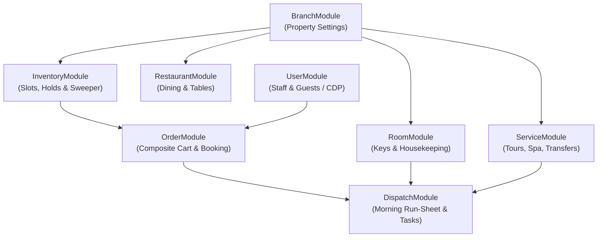

# Yoonie Backend Documentation

Complete technical and architectural documentation index for the `yoonie-backend` hospitality platform.

---

## Documentation Index

| Document | Purpose |
| :--- | :--- |
| [**`SYSTEM_FLOWS.md`**](./SYSTEM_FLOWS.md) | **System Architecture & Operational Flows**: Sequence diagrams for guest booking journeys, cart holds, background sweeper, 05:30 AM dispatch generation, and housekeeping front-desk zero workflows. |
| [**`FRONTEND_API.md`**](./FRONTEND_API.md) | **Frontend API Integration Guide**: Exhaustive endpoint references across all 7 domain modules with query parameters, request bodies, response schemas, and TypeScript/Axios code snippets. |
| [**`DATA_MODEL.md`**](./DATA_MODEL.md) | **Data Model & Lifecycles**: Full Entity-Relationship Diagram (ERD), collection index, and the 5 state machine lifecycles (`Order`, `OrderLine`, `InventorySlot`, `Room`, `OperationalDispatch`). |

---

## Core System Architecture

