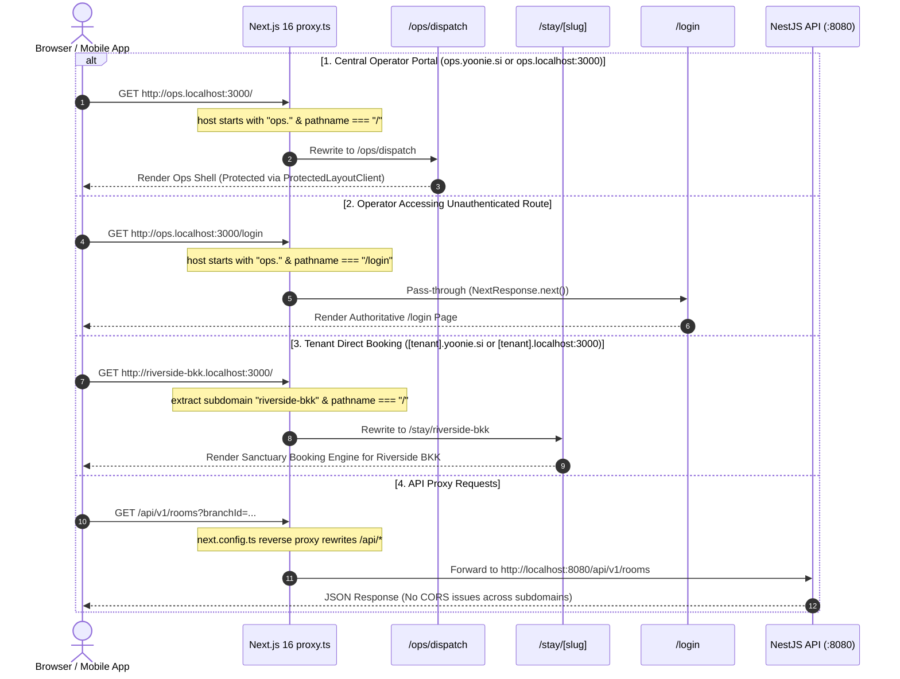
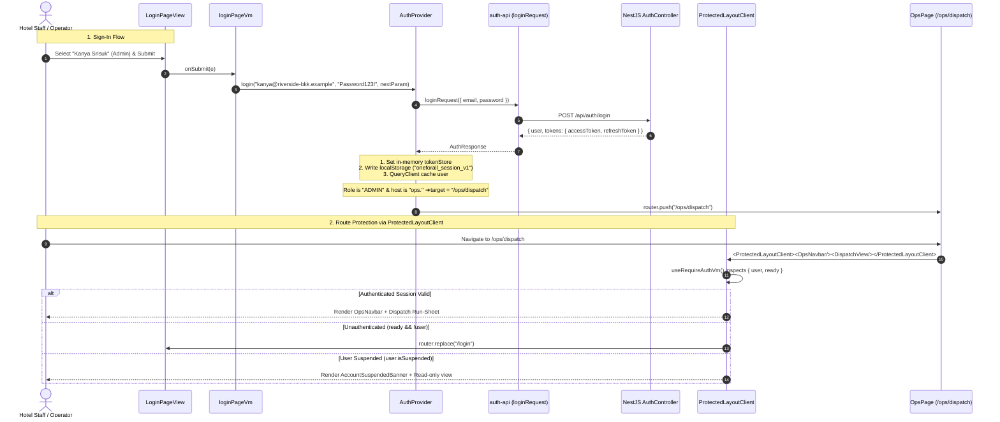
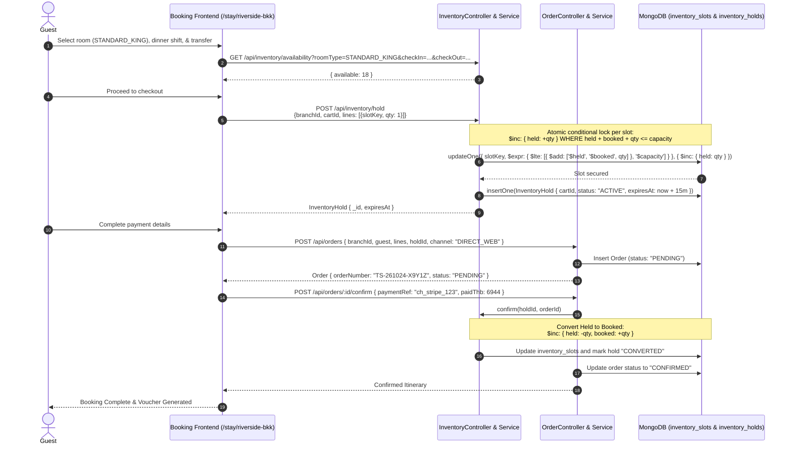
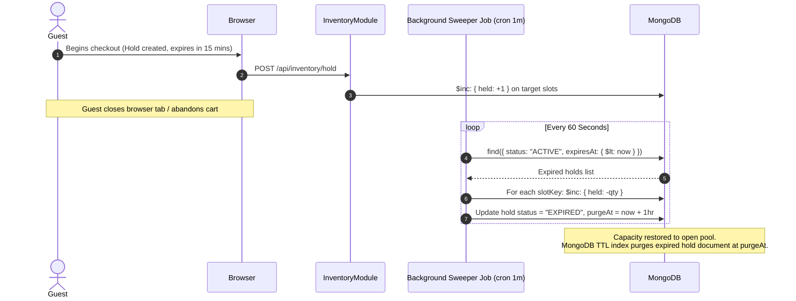
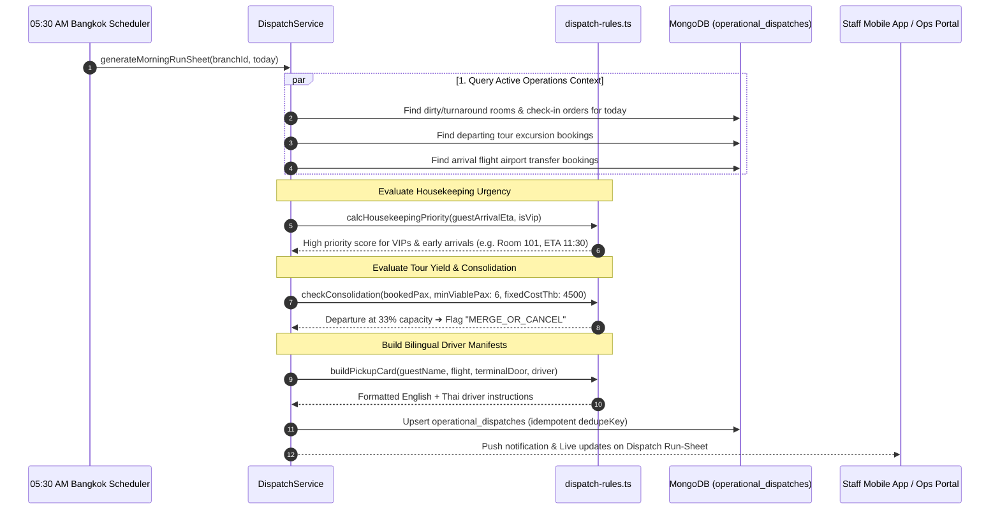
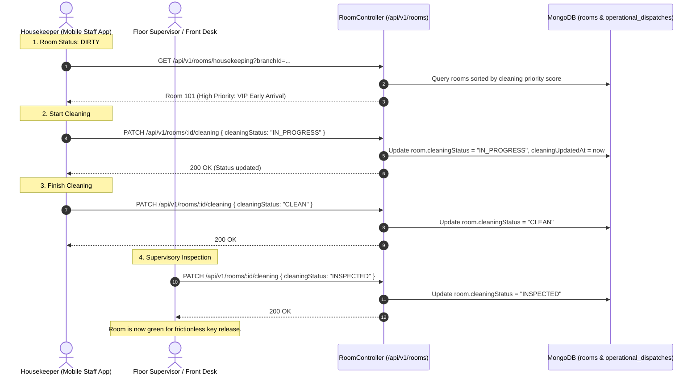
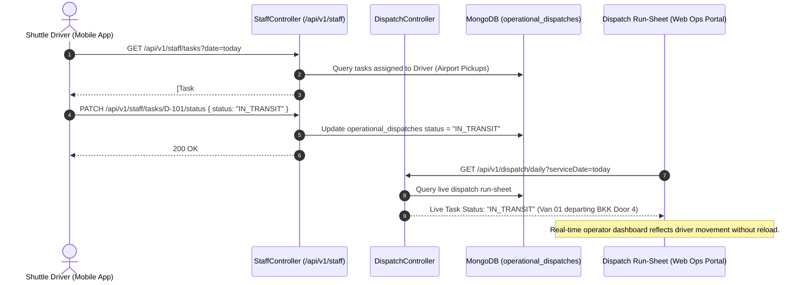

# System Architecture & Operational Sequence Flows

Comprehensive sequence diagrams and operational workflows for the **Yoonie Unified Hospitality Operating System**, covering multi-tenant edge routing, authentication, protected layouts, inventory concurrency, morning dispatch, and housekeeping turnarounds.

---

## 1. Multi-Tenant Subdomain Routing (`proxy.ts`)

How Next.js 16 Edge Proxy resolves requests across tenant direct booking, central operator hub, and root platform.

---

## 2. Authentication, Token Lifecycle & ProtectedLayoutClient

Complete authentication, session restoration, role-based redirection, and route protection.

---

## 3. Direct Guest Multi-Product Booking & Atomic Inventory Hold

Guests select a room, dinner shift, and airport transfer in one cart. Capacity is locked using atomic conditional increments.

---

## 4. Cart Abandonment & Automated Capacity Sweeper

If a guest leaves during checkout, inventory is safely restored to the selling pool.

---

## 5. 05:30 AM Morning Dispatch Run-Sheet Generation

The automated air-traffic controller for frontline operations running at 05:30 Bangkok time (`Asia/Bangkok`).

---

## 6. Front-Desk Zero Housekeeping Turnaround Lifecycle

Room turnaround prioritized dynamically by incoming guest logistics.

---

## 7. Staff Mobile App Real-Time Status Synchronization

Frontline drivers and housekeepers updating operational dispatch tasks via mobile API.

